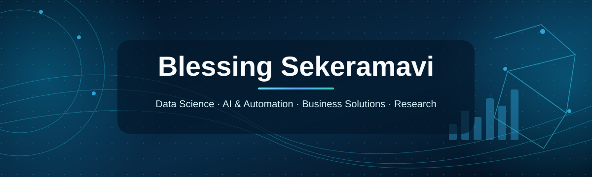
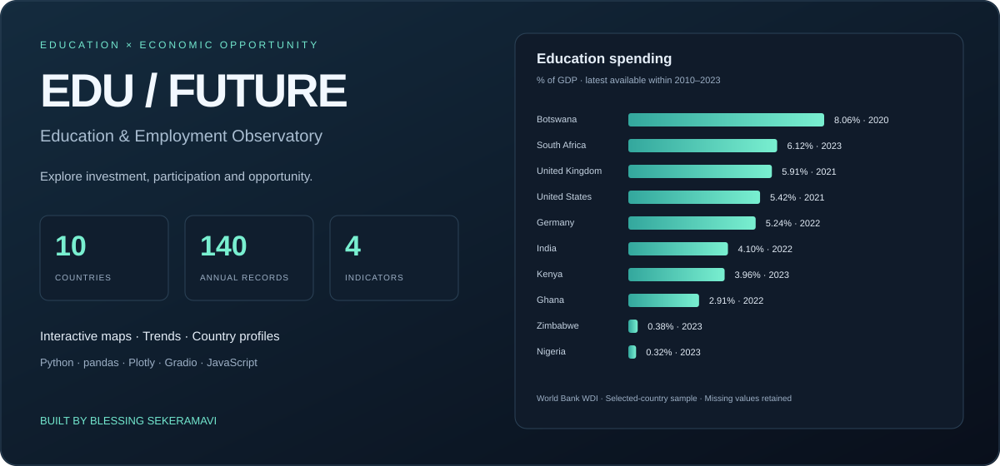
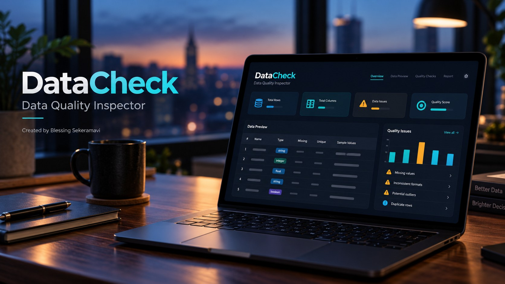

# Hi, I'm Blessing Sekeramavi 👋

### Data Science · AI & Automation · Business Solutions · Research

I'm a data science graduate and international outreach project coordinator based in Bremen, Germany. I enjoy turning complex problems into practical solutions using research, data, technology and cross-functional collaboration.

My interests span **applied machine learning, business intelligence, workflow automation, education, climate and marine data, and social impact**. I bring together a background in **law and business** with a master's degree in **Data Science for Society & Business**.

## Live Streamlit apps

| App | Hosted demo |
| --- | --- |
| DataCheck | [Open app](https://wruj3msd9wtshpkozw4lvd.streamlit.app/) |
| StudentLens | [Open app](https://blessing-studentlens.streamlit.app/) |
| ApexLab | [Open app](https://appapppy-qrqmlbp7gpmxpbkrs5sm4w.streamlit.app/) |
| Edu-future-observatory. | [Open app](https://blessing-edu-future.streamlit.app/) |
| UniversityScope | [Open app](https://blessing-universityscope.streamlit.app/) |

UniversityScope includes published reports; upload a THE rankings CSV for the interactive institution explorer.

## Featured projects

### UniversityScope

**University performance analytics built around 3,146 institution records across 131 countries and territories.** Includes six reproducible visual reports, interactive country maps, institution comparisons and exploratory K-Means clustering.

Built with **Python, pandas, scikit-learn, Matplotlib, D3 and Globe.gl**, connecting my data science training with my experience in international university outreach.

[**Try the live software demo**](https://universityscope-blessing.pearlypanda9.chatgpt.site) · [**Explore the project and visual reports**](https://github.com/BlessingSK1998/UniversityScope) · [**Open the interactive notebook in Colab**](https://colab.research.google.com/github/BlessingSK1998/UniversityScope/blob/main/UniversityScope.ipynb)

---

### EDU / FUTURE — Education & Employment Observatory

**Interactive World Bank analytics across 10 countries, 140 country-year records and four indicators (2010–2023).** Explore education spending, tertiary enrolment, youth unemployment and GDP per capita through a world map, country comparisons, historical trends and country profiles.

Built with **Python, pandas, NumPy, Plotly, Gradio and JavaScript**, with a public browser dashboard, reproducible Colab notebook, CSV exports, data-quality checks and transparent source documentation.

[**Try the live dashboard**](https://edu-future-blessing-observatory.pearlypanda9.chatgpt.site) · [**Explore the full project**](https://github.com/BlessingSK1998/Edu-future-observatory.) · [**Open the notebook in Colab**](https://colab.research.google.com/github/BlessingSK1998/Edu-future-observatory./blob/main/global-education-employment.ipynb)

---

### ApexLab — Hamilton vs Norris, Barcelona 2026

**An interactive look inside Hamilton’s Barcelona victory: 1,241 recorded laps, 22 drivers and a 66-lap race.** Replay the running order, compare Hamilton, Russell and Norris, inspect tyre stints and pit stops, then explore an illustrative strategy simulator.

Built with **Python, pandas, NumPy, JavaScript and Plotly**, using recorded OpenF1 data, explicit data-quality checks and reproducible analysis. Simulated outcomes are clearly separated from race observations.

[**Open the live race lab**](https://apexlab-hamilton-barcelona.pearlypanda9.chatgpt.site) · [**Explore the full project**](https://github.com/BlessingSK1998/ApexLab)

*Cover: AI-generated editorial illustration, not an authentic race photograph.*

## What I work on

- **Data science & machine learning:** predictive modeling, evaluation, visualization and responsible decision support.
- **Business solutions:** operational analytics, market research, strategy and process improvement.
- **AI agents & workflow automation:** building and experimenting with n8n workflows and AI-supported research and reporting.
- **Research for impact:** exploring applications in education, public health, marine ecosystems and development.
- **International collaboration:** coordinating stakeholders, academic initiatives and international outreach.

## Selected projects

### DataCheck — Data Quality Inspector

  

[View the full-resolution cover](./assets/datacheck-cover-v2.jpg)

**A public Streamlit app that turns CSV uploads into clear, actionable data-quality reports.** Inspect missing values, duplicates, whitespace, category inconsistencies and potential outliers, validate student data against a predefined schema, and preview optional cleaning before downloading results.

Built with **Python, pandas, NumPy and Streamlit**, with nine automated tests, downloadable JSON reports and transparent cleaning logs.

[**Use the DataCheck app**](https://wruj3msd9wtshpkozw4lvd.streamlit.app/) · [**Explore the code**](https://github.com/BlessingSK1998/DataCheck)

*Cover: AI-generated product illustration, not an exact application screenshot.*

| Project | Focus | Repository |
| --- | --- | --- |
| DataCheck app | CSV quality checks, student schema validation and transparent cleaning | [View project](https://github.com/BlessingSK1998/DataCheck) · [Live app](https://wruj3msd9wtshpkozw4lvd.streamlit.app/) |
| ApexLab | F1 race replay, tyre strategy, pace analysis and illustrative simulation | [View project](https://github.com/BlessingSK1998/ApexLab) |
| EDU / FUTURE | Education investment, youth employment, country comparisons and data quality | [View project](https://github.com/BlessingSK1998/Edu-future-observatory.) |
| Student Dropout & Academic Success | Predictive modeling, uncertainty, fairness and education decision support | [View project](https://github.com/BlessingSK1998/Predict-Students-Dropout-and-Academic-Success) |
| Cancer Variant Machine Learning | Comparing ML models and examining the limits of predictive signal | [View project](https://github.com/BlessingSK1998/Cancer-Variant-Dataset-for-Machine-Learning) |
| OceanScope AI Observatory | Marine and climate data exploration *(in development)* | [View repository](https://github.com/BlessingSK1998/OceanScope-AI-Observatory) |

## What I'm building next

- **Business Intelligence Toolkit:** practical dashboards and analysis for operational and commercial questions.
- **AI Workflow Automation Lab:** documented n8n and Python automations for research, reporting and repetitive workflows.
- **Marine & Climate Data Portfolio:** reproducible exploration of publicly available environmental datasets.
- **Applied Research Projects:** transparent and responsible machine-learning experiments.

*These are planned directions, not claims of completed or deployed projects.*

## Tools & approaches

**Python · pandas · NumPy · scikit-learn · XGBoost · Plotly · Jupyter · Data visualization · Statistical analysis**

Currently exploring **AI agents, n8n automation and end-to-end applied analytics workflows**.

## Let's collaborate

I'm interested in opportunities and collaborations involving **data science, applied AI, research, business analysis, project coordination and automation**.

📍 Bremen, Germany  
🔗 [Explore my repositories](https://github.com/BlessingSK1998)

---
*I aim to build clear, reproducible projects that explain the question, data, methods, limitations and practical implications—not just present a model score.*
